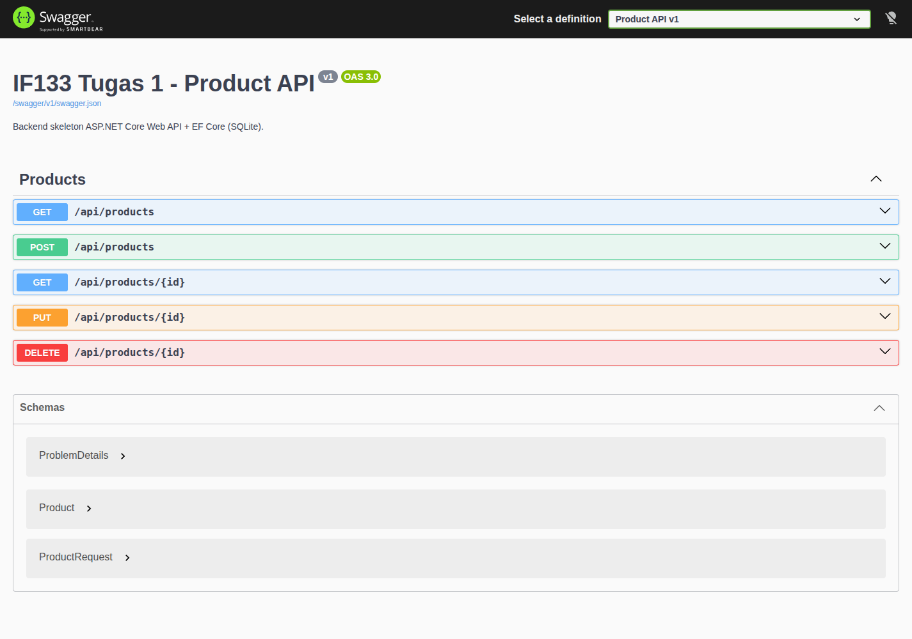
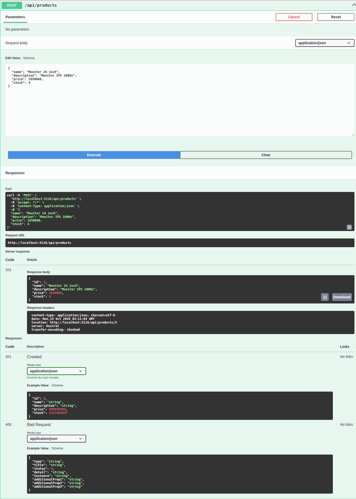
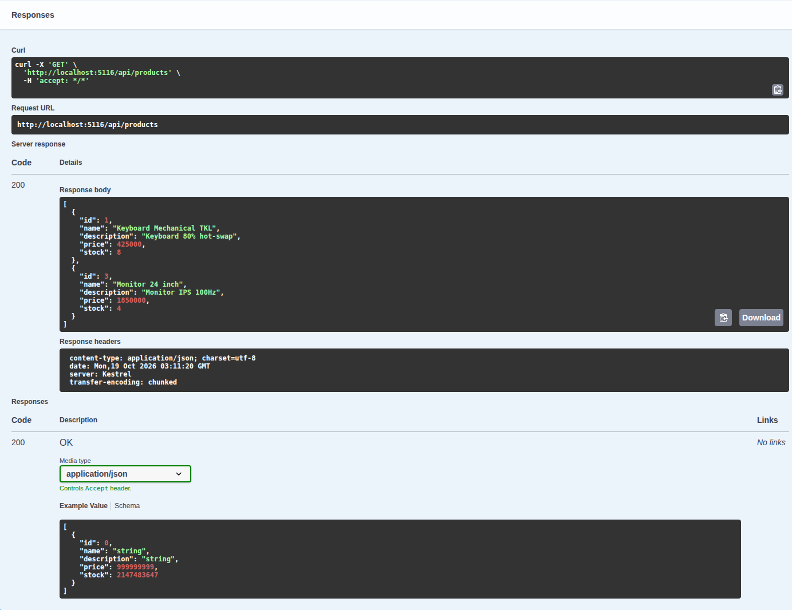
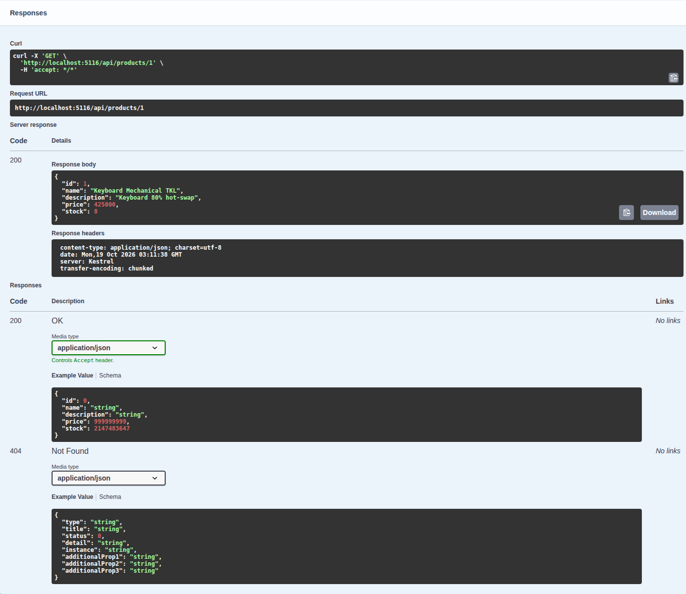
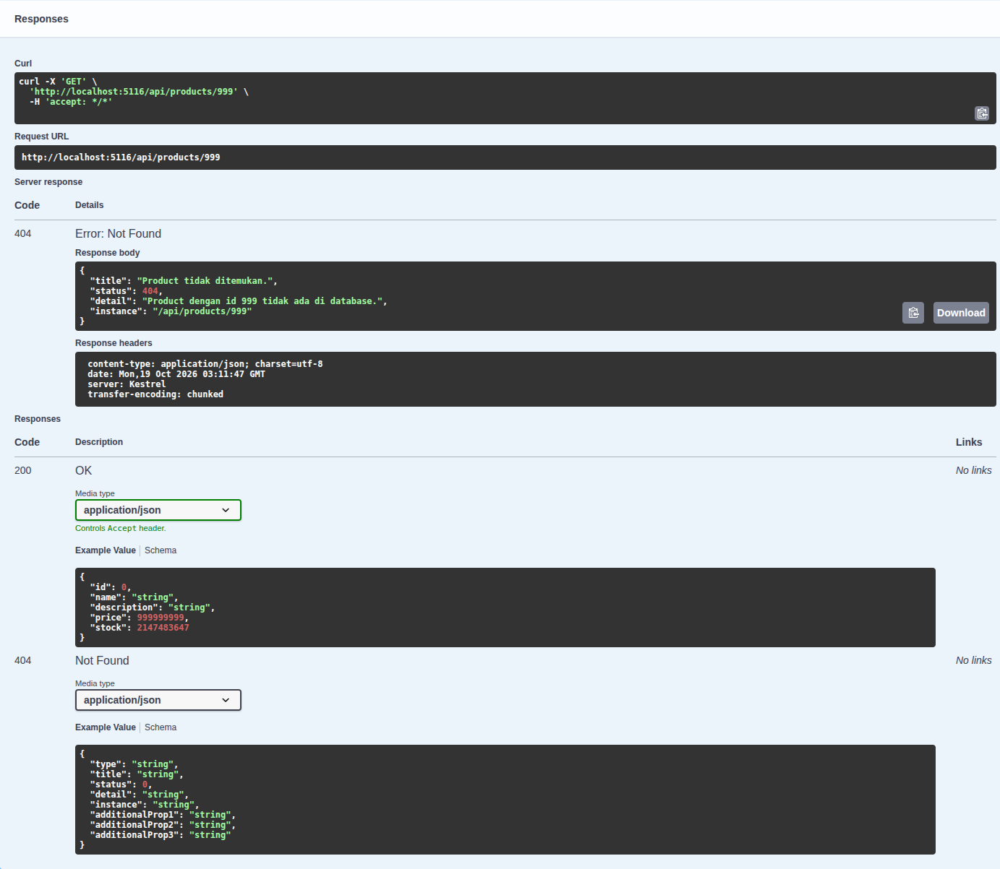
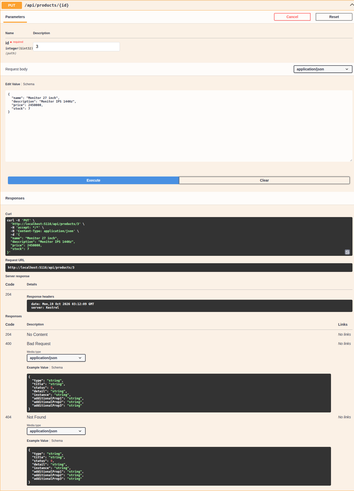
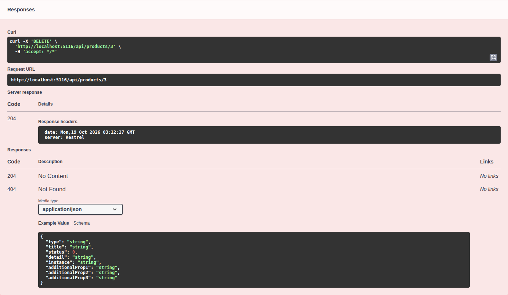
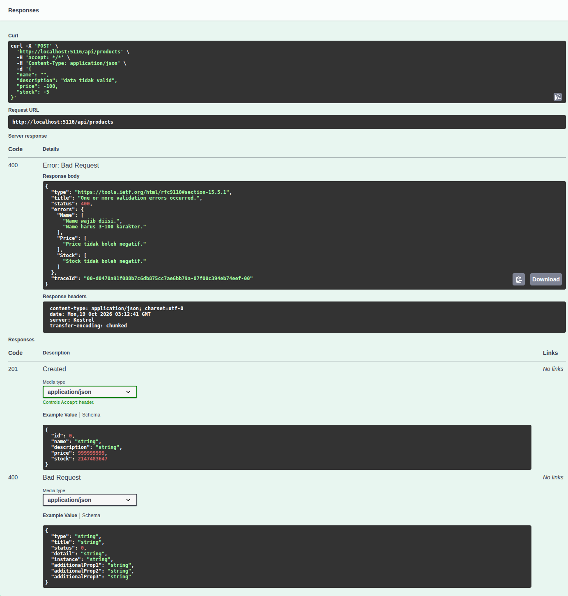

# IF133 - Tugas 1: Backend Skeleton & Data Persistence

## Identitas

- **Nama:** Muhammad Farid Zaki
- **NIM:** 1003240010
- **Prodi:** Informatika

## Studi Kasus

Studi kasus yang dipilih adalah **Produk / Inventory** dengan satu entity utama `Product`.
Aplikasi ini adalah backend REST API untuk mengelola daftar produk pada sebuah toko:
menambah produk baru, melihat daftar produk, melihat detail satu produk, memperbarui
data produk, dan menghapus produk.

Entity `Product` memiliki 4 field selain `Id`:

| Field | Tipe | Wajib | Aturan Validasi |
|---|---|---|---|
| `Id` | `int` | Ya | Primary key, auto-increment oleh database |
| `Name` | `string` | Ya | Tidak boleh kosong, panjang 3-100 karakter |
| `Description` | `string?` | Tidak | Maksimal 250 karakter |
| `Price` | `decimal` | Ya | `>= 0` |
| `Stock` | `int` | Ya | `>= 0` |

## Teknologi

- **ASP.NET Core Web API** (berbasis controller) - .NET 10
- **Entity Framework Core** 10.0.13 (Code First + Migration)
- **Database provider:** SQLite (`Microsoft.EntityFrameworkCore.Sqlite`)
- **Swashbuckle.AspNetCore** untuk Swagger / OpenAPI UI

## Lingkungan Pengembangan

Project ini dikembangkan dan diuji sepenuhnya di **Linux**, bukan Windows:

| Komponen | Nilai |
|---|---|
| Sistem operasi | Pop!_OS 24.04 LTS (basis Ubuntu), kernel Linux 7.2.6 |
| .NET SDK | 10.0.401 (`/home/glianalabs/.dotnet/dotnet`) |
| EF Core CLI | dotnet-ef 10.0.13 (global tool) |
| Editor | VS Code + terminal (tanpa Visual Studio) |
| Database | SQLite, file `products.db` |

ASP.NET Core dan EF Core bersifat lintas platform, sehingga seluruh perintah
`dotnet new`, `dotnet build`, `dotnet ef`, dan `dotnet run` berjalan sama di Linux
maupun Windows. Pemilihan **SQLite** juga membuat project tetap portabel: tidak
bergantung pada SQL Server LocalDB yang hanya tersedia di Windows.

Jika project ini dibuka di Windows, tidak ada perubahan kode yang diperlukan.
Perbedaannya hanya pada hal di luar kode, misalnya cara memeriksa isi database
(`sqlite3` di terminal Linux, atau DB Browser for SQLite di Windows).

## Struktur Solution / Project

```
IF133_Tugas1_1003240010_MuhammadFaridZaki/
├── IF133.Tugas1.slnx              # Solution file
├── README.md                      # Dokumentasi ini
├── .gitignore
├── docs/
│   └── screenshots/               # Bukti pengujian Swagger UI (8 gambar)
└── IF133.Tugas1.Api/              # Project Web API
    ├── Controllers/
    │   └── ProductsController.cs  # Endpoint CRUD /api/products
    ├── Data/
    │   └── AppDbContext.cs        # DbContext + DbSet<Product>
    ├── Entities/
    │   └── Product.cs             # Entity utama + validasi
    ├── Dtos/
    │   └── ProductRequest.cs      # Body request POST/PUT
    ├── Migrations/
    │   ├── 20261019030354_InitialCreate.cs
    │   ├── 20261019030354_InitialCreate.Designer.cs
    │   └── AppDbContextModelSnapshot.cs
    ├── Properties/
    │   └── launchSettings.json    # Profil http (port 5116) dan https
    ├── Program.cs                 # Konfigurasi DI, DbContext, Swagger, routing
    ├── appsettings.json           # Connection string SQLite
    ├── products.db                # Database SQLite hasil migration
    └── IF133.Tugas1.Api.csproj
```

**Penjelasan folder penting:**

- `Entities/` - definisi model data (POCO) beserta aturan validasi lewat Data Annotations.
- `Data/` - lapisan persistence: `AppDbContext` yang memetakan entity ke tabel database.
- `Dtos/` - objek body request. Dipisah dari entity agar `Id` tidak bisa dikirim/ditimpa oleh client (mencegah over-posting).
- `Controllers/` - lapisan HTTP: menerima request, memanggil DbContext, mengembalikan status code yang sesuai.
- `Migrations/` - riwayat perubahan skema database yang di-generate EF Core.

## Entity dan DbContext

**`Entities/Product.cs`** (bagian relevan):

```csharp
public class Product
{
    public int Id { get; set; }

    [Required(ErrorMessage = "Name wajib diisi.")]
    [StringLength(100, MinimumLength = 3, ErrorMessage = "Name harus 3-100 karakter.")]
    public string Name { get; set; } = string.Empty;

    [StringLength(250, ErrorMessage = "Description maksimal 250 karakter.")]
    public string? Description { get; set; }

    [Range(0, 999_999_999, ErrorMessage = "Price tidak boleh negatif.")]
    public decimal Price { get; set; }

    [Range(0, int.MaxValue, ErrorMessage = "Stock tidak boleh negatif.")]
    public int Stock { get; set; }
}
```

**`Data/AppDbContext.cs`** (bagian relevan):

```csharp
public class AppDbContext : DbContext
{
    public AppDbContext(DbContextOptions<AppDbContext> options) : base(options) { }

    public DbSet<Product> Products => Set<Product>();

    protected override void OnModelCreating(ModelBuilder modelBuilder)
    {
        modelBuilder.Entity<Product>(entity =>
        {
            entity.HasKey(p => p.Id);
            entity.Property(p => p.Name).IsRequired().HasMaxLength(100);
            entity.Property(p => p.Description).HasMaxLength(250);
            entity.Property(p => p.Price).HasColumnType("TEXT");
        });
    }
}
```

## Konfigurasi Database dan Migration

**Connection string** disimpan di `appsettings.json` (bukan di controller):

```json
"ConnectionStrings": {
  "DefaultConnection": "Data Source=products.db"
}
```

**Registrasi DbContext lewat dependency injection** di `Program.cs`:

```csharp
builder.Services.AddDbContext<AppDbContext>(options =>
    options.UseSqlite(builder.Configuration.GetConnectionString("DefaultConnection")));
```

**Command migration yang dijalankan:**

```bash
dotnet ef migrations add InitialCreate --project IF133.Tugas1.Api
dotnet ef database update --project IF133.Tugas1.Api
```

Hasil: migration `20261019030354_InitialCreate` berhasil dibuat dan diterapkan
(`Done.`), lalu file `IF133.Tugas1.Api/products.db` terbentuk.

**Struktur tabel yang terbentuk** (`sqlite3 products.db ".schema"`):

```sql
CREATE TABLE "Products" (
    "Id" INTEGER NOT NULL CONSTRAINT "PK_Products" PRIMARY KEY AUTOINCREMENT,
    "Name" TEXT NOT NULL,
    "Description" TEXT NULL,
    "Price" TEXT NOT NULL,
    "Stock" INTEGER NOT NULL
);

CREATE TABLE "__EFMigrationsHistory" (
    "MigrationId" TEXT NOT NULL CONSTRAINT "PK___EFMigrationsHistory" PRIMARY KEY,
    "ProductVersion" TEXT NOT NULL
);
```

Tabel `__EFMigrationsHistory` adalah tabel bawaan EF Core yang mencatat migration
mana saja yang sudah diterapkan, sehingga `database update` tidak menjalankan
migration yang sama dua kali.

## Cara Menjalankan

**Prasyarat:** .NET SDK 10 dan EF Core CLI.

```bash
# 1. Install EF Core CLI (sekali saja)
dotnet tool install --global dotnet-ef

# 2. Restore dependency
dotnet restore

# 3. Buat/perbarui database dari migration
dotnet ef database update --project IF133.Tugas1.Api

# 4. Jalankan project
dotnet run --project IF133.Tugas1.Api --launch-profile http
```

Setelah berjalan, buka Swagger UI di **<http://localhost:5116/>**.

## Endpoint

Base URL: `http://localhost:5116`

| Operasi | Method | Endpoint | Body | Success | Error |
|---|---|---|---|---|---|
| Read all | `GET` | `/api/products` | - | `200 OK` + array | `500` |
| Read one | `GET` | `/api/products/{id}` | - | `200 OK` + object | `404` |
| Create | `POST` | `/api/products` | JSON | `201 Created` + object | `400` |
| Update | `PUT` | `/api/products/{id}` | JSON | `204 No Content` | `400` / `404` |
| Delete | `DELETE` | `/api/products/{id}` | - | `204 No Content` | `404` |

Penamaan endpoint bersifat **resource-oriented** (`/api/products`, plural dan konsisten),
bukan procedural seperti `/getAllProduct`.

**Contoh request:**

```http
POST /api/products
Content-Type: application/json

{
  "name": "Keyboard Mechanical",
  "description": "Keyboard 75%",
  "price": 350000,
  "stock": 5
}
```

**Contoh response:**

```http
HTTP/1.1 201 Created
Content-Type: application/json
Location: http://localhost:5116/api/products/1

{
  "id": 1,
  "name": "Keyboard Mechanical",
  "description": "Keyboard 75%",
  "price": 350000,
  "stock": 5
}
```

## Bukti Pengujian

Seluruh skenario di bawah dijalankan terhadap API yang sedang berjalan di
`http://localhost:5116`. Status code adalah hasil respons sebenarnya.

| No | Skenario | Method + Endpoint | Input | Status Code | Hasil |
|---|---|---|---|---|---|
| 1 | GET seluruh data (database kosong) | `GET /api/products` | - | **200 OK** | `[]` |
| 2 | POST data valid | `POST /api/products` | `{"name":"Keyboard Mechanical","description":"Keyboard 75%","price":350000,"stock":5}` | **201 Created** | `{"id":1,...}` |
| 3 | POST data valid kedua | `POST /api/products` | `{"name":"Mouse Wireless","description":"Mouse ergonomis","price":150000,"stock":12}` | **201 Created** | `{"id":2,...}` |
| 4 | GET by id valid | `GET /api/products/1` | - | **200 OK** | satu object produk |
| 5 | PUT data valid | `PUT /api/products/1` | `{"name":"Keyboard Mechanical TKL","description":"Keyboard 80% hot-swap","price":425000,"stock":8}` | **204 No Content** | body kosong; data berubah |
| 6 | Verifikasi hasil PUT | `GET /api/products/1` | - | **200 OK** | `{"id":1,"name":"Keyboard Mechanical TKL","price":425000.0,"stock":8}` |
| 7 | DELETE data valid | `DELETE /api/products/2` | - | **204 No Content** | data id 2 terhapus |
| 8 | **GAGAL** - GET id tidak ada | `GET /api/products/999` | - | **404 Not Found** | `{"title":"Product tidak ditemukan.","status":404,...}` |
| 9 | **GAGAL** - POST data tidak valid | `POST /api/products` | `{"name":"","description":"tes","price":-100,"stock":-5}` | **400 Bad Request** | errors: Name, Price, Stock |
| 10 | **GAGAL** - PUT id tidak ada | `PUT /api/products/999` | body valid | **404 Not Found** | `{"title":"Product tidak ditemukan.",...}` |
| 11 | **GAGAL** - DELETE id tidak ada | `DELETE /api/products/999` | - | **404 Not Found** | `{"title":"Product tidak ditemukan.",...}` |
| 12 | GET seluruh data (akhir) | `GET /api/products` | - | **200 OK** | array berisi 1 produk |
| 13 | Swagger UI terbuka | `GET /` | - | **200 OK** | halaman Swagger UI tampil |
| 14 | Dokumen OpenAPI tersedia | `GET /swagger/v1/swagger.json` | - | **200 OK** | spesifikasi OpenAPI |

**Bukti response skenario gagal nomor 9 (validasi, 400):**

```json
{
  "type": "https://tools.ietf.org/html/rfc9110#section-15.5.1",
  "title": "One or more validation errors occurred.",
  "status": 400,
  "errors": {
    "Name": ["Name wajib diisi.", "Name harus 3-100 karakter."],
    "Price": ["Price tidak boleh negatif."],
    "Stock": ["Stock tidak boleh negatif."]
  }
}
```

**Bukti response skenario gagal nomor 8 (404):**

```json
{
  "title": "Product tidak ditemukan.",
  "status": 404,
  "detail": "Product dengan id 999 tidak ada di database.",
  "instance": "/api/products/999"
}
```

**Bukti persistence:** setelah aplikasi dihentikan, data tetap ada di file database:

```bash
$ sqlite3 IF133.Tugas1.Api/products.db "SELECT * FROM Products;"
1|Keyboard Mechanical TKL|Keyboard 80% hot-swap|425000.0|8
```

### Screenshot Swagger UI

Sesi pengujian lewat Swagger UI dijalankan terpisah dari tabel di atas, sehingga
id produk yang dipakai berbeda (produk baru yang dibuat mendapat `id = 3`).

**1. Swagger UI terbuka, seluruh endpoint CRUD terdaftar**



**2. POST /api/products - data valid -> 201 Created**

Response body berisi `id` hasil generate database dan response header memuat
`location: http://localhost:5116/api/products/3`.



**3. GET /api/products - 200 OK**



**4. GET /api/products/1 - 200 OK**



**5. GET /api/products/999 - 404 Not Found (skenario gagal)**



**6. PUT /api/products/3 - 204 No Content**



**7. DELETE /api/products/3 - 204 No Content**



**8. POST /api/products - data tidak valid -> 400 Bad Request (skenario gagal)**

Pesan validasi muncul per field: `Name`, `Price`, dan `Stock`.



## Hubungan Antar Komponen

```
HTTP Request
    │
    ▼
ProductsController  ──┐  menerima request, validasi otomatis ([ApiController]),
(/api/products)       │  menentukan HTTP status code
                      ▼
                 AppDbContext   DbSet<Product> = representasi tabel Products
                      │         (disuntik lewat dependency injection)
                      ▼
                  EF Core + provider SQLite
                      │         menerjemahkan LINQ menjadi SQL
                      ▼
                 products.db    tabel dibuat oleh Migration InitialCreate
```

- **Entity** mendefinisikan bentuk data dan aturan validasi.
- **DbContext** memetakan entity ke tabel dan menjadi pintu akses database.
- **Migration** menerjemahkan model C# menjadi perintah DDL (`CREATE TABLE`) pada database.
- **Controller** memetakan HTTP method ke operasi CRUD dan memilih status code yang tepat.
- **Response** dibentuk dari hasil query, diserialisasi menjadi JSON.

## Kendala dan Solusi

1. **`dotnet ef` tidak dikenali.**
   Perintah `dotnet ef migrations add` gagal dengan pesan
   `dotnet-ef does not exist`, karena EF Core CLI adalah global tool terpisah
   dan belum terpasang.
   **Solusi:** menjalankan `dotnet tool install --global dotnet-ef`, lalu memastikan
   `$HOME/.dotnet/tools` ada pada `PATH`.

2. **Build error `CS0234: The type or namespace name 'Models' does not exist in the namespace 'Microsoft.OpenApi'`.**
   Konfigurasi Swagger awalnya ditulis `new Microsoft.OpenApi.Models.OpenApiInfo { ... }`
   mengikuti contoh lama. Pada Swashbuckle 10 (yang memakai Microsoft.OpenApi v2)
   kelas `OpenApiInfo` dipindah ke namespace akar.
   **Solusi:** mengubahnya menjadi `new Microsoft.OpenApi.OpenApiInfo { ... }`, build kembali berhasil (0 error).

3. **Template `dotnet new webapi` .NET 10 tidak menyediakan Swagger UI.**
   Template hanya memasang `AddOpenApi()`/`MapOpenApi()` yang menghasilkan dokumen
   JSON tanpa tampilan UI, sehingga endpoint sulit diuji lewat browser.
   **Solusi:** menambahkan package `Swashbuckle.AspNetCore`, memakai
   `AddSwaggerGen()` + `UseSwaggerUI()` dengan `RoutePrefix = string.Empty`
   agar Swagger UI langsung terbuka di root URL.

4. **SQLite tidak memiliki tipe `decimal` native.**
   Field `Price` bertipe `decimal` berisiko kehilangan presisi bila disimpan sebagai `REAL`.
   **Solusi:** memetakan kolom `Price` ke tipe `TEXT` lewat
   `entity.Property(p => p.Price).HasColumnType("TEXT")` pada `OnModelCreating`,
   sehingga nilai uang tersimpan persis.

5. **`UseHttpsRedirection()` mengganggu pengujian lewat HTTP.**
   Saat dijalankan dengan profil `http`, middleware ini menghasilkan peringatan
   karena port HTTPS tidak tersedia.
   **Solusi:** redirect HTTPS hanya diaktifkan di luar environment Development,
   sementara di Development yang aktif adalah Swagger UI.

6. **Port 5116 sudah dipakai: `AddressInUseException`, proses berhenti dengan exit code 134.**
   Saat menjalankan ulang `dotnet run`, aplikasi gagal start dengan pesan:

   ```
   Unhandled exception. System.IO.IOException: Failed to bind to address
   http://127.0.0.1:5116: address already in use.
    ---> Microsoft.AspNetCore.Connections.AddressInUseException: Address already in use
    ---> System.Net.Sockets.SocketException (98): Address already in use
   ```

   Penyebabnya adalah instance lama dari sesi pengujian sebelumnya yang masih hidup.
   Upaya menghentikannya dengan `pkill -f 'dotnet.*Tugas1.Api.dll'` tidak mengenai
   sasaran, karena di Linux proses yang benar-benar berjalan adalah **apphost**
   (`bin/Debug/net10.0/IF133.Tugas1.Api`), bukan `dotnet <nama>.dll`.
   **Solusi:** memeriksa pemilik port lalu menghentikan proses yang tepat:

   ```bash
   ss -ltnp | grep :5116
   pkill -f 'bin/Debug/net10.0/IF133.Tugas1.Api'
   ```

   Pelajaran: satu port hanya boleh dipakai satu proses, dan proses lama wajib
   dipastikan mati sebelum menjalankan ulang aplikasi.

7. **Sertifikat HTTPS development tidak ter-trust di Linux.**
   Pemeriksaan sertifikat menunjukkan sertifikat ada tetapi belum dipercaya sistem:

   ```
   $ dotnet dev-certs https --check --trust
   The following certificates were found, but none of them is trusted: 1 certificate
       1) ... - CN=localhost - IsHttpsDevelopmentCertificate: true
   ```

   Di Linux, `dotnet dev-certs https --trust` tidak dapat memasang kepercayaan
   secara menyeluruh seperti di Windows, karena setiap browser dan tool memakai
   trust store masing-masing. Akibatnya pengujian lewat HTTPS berpotensi tertahan
   peringatan sertifikat.
   **Solusi:** pengujian dijalankan memakai profil `http`
   (`dotnet run --launch-profile http`) pada `http://localhost:5116`, dan
   `UseHttpsRedirection()` hanya diaktifkan di luar environment Development.
   Untuk deployment nyata, HTTPS tetap aktif karena ditangani environment produksi.

8. **Tidak tersedia Visual Studio dan SQL Server LocalDB.**
   Materi .NET umumnya mengasumsikan Visual Studio di Windows, sedangkan project ini
   dikerjakan di Pop!_OS 24.04. Visual Studio dan SQL Server LocalDB keduanya
   hanya berjalan di Windows.
   **Solusi:** seluruh pekerjaan dilakukan lewat **.NET CLI** (`dotnet new`,
   `dotnet sln`, `dotnet add package`, `dotnet ef`, `dotnet build`, `dotnet run`)
   dengan editor VS Code, dan database memakai **SQLite** yang lintas platform.
   Hasilnya tetap satu solution .NET standar yang bisa dibuka di Windows tanpa
   perubahan kode.

## Checklist Sebelum Submit

| No | Checklist | Status |
|---|---|---|
| 1 | Solution dapat dibuka dan build tanpa error kritis | [x] `dotnet build` -> 0 error, 0 warning |
| 2 | Web API dapat dijalankan dengan `dotnet run` | [x] berjalan di `http://localhost:5116` |
| 3 | Entity dan DbContext tersedia dan sesuai studi kasus | [x] `Product` + `AppDbContext` |
| 4 | Migration berhasil dan database telah terbentuk | [x] `InitialCreate` + `products.db` |
| 5 | GET all dan GET by id berfungsi | [x] 200 OK |
| 6 | POST berfungsi dan menghasilkan data baru | [x] 201 Created + header `Location` |
| 7 | PUT berfungsi untuk memperbarui data | [x] 204 No Content |
| 8 | DELETE berfungsi untuk menghapus data | [x] 204 No Content |
| 9 | 404 muncul ketika ID tidak ditemukan | [x] GET/PUT/DELETE id 999 |
| 10 | 400 muncul untuk input yang tidak valid | [x] validasi Name/Price/Stock |
| 11 | Swagger menunjukkan request dan response yang sesuai | [x] 8 screenshot terlampir |
| 12 | Dokumentasi README menjelaskan cara menjalankan project | [x] bagian "Cara Menjalankan" |
| 13 | Tidak ada secret/password/token pribadi di repository | [x] hanya connection string SQLite lokal |

## Kesimpulan

Seluruh ketentuan teknis minimal terpenuhi: solution dengan satu project Web API
berbasis controller, satu entity utama `Product` beserta `AppDbContext`, persistence
dengan EF Core + provider SQLite, migration `InitialCreate` yang berhasil membentuk
tabel `Products`, dan lima endpoint CRUD (`GET all`, `GET by id`, `POST`, `PUT`,
`DELETE`) dengan HTTP method serta status code sesuai konteks (200/201/204/400/404).

Pengujian mencakup 14 skenario dan empat di antaranya adalah skenario gagal
(404 untuk GET/PUT/DELETE pada id yang tidak ada, dan 400 untuk input tidak valid),
sehingga validasi dan penanganan error terbukti bekerja. Data juga terbukti benar-benar
tersimpan: isi tabel tetap ada setelah aplikasi dihentikan.

Delapan kendala teknis terdokumentasi dan seluruhnya terselesaikan. Sumbernya ada
dua: **perbedaan versi** (EF CLI belum terpasang, perubahan namespace
Microsoft.OpenApi v2, template .NET 10 tanpa Swagger UI, SQLite tanpa tipe
`decimal`), dan **perbedaan platform** karena pengerjaan dilakukan di Linux
(Pop!_OS 24.04) tanpa Visual Studio maupun SQL Server LocalDB, sertifikat HTTPS
development yang tidak ter-trust, serta proses lama yang masih menahan port 5116.

Semuanya diselesaikan dengan membaca pesan error, memeriksa kondisi sistem, dan
menyesuaikan konfigurasi. Pilihan .NET CLI + SQLite terbukti membuat project tetap
lintas platform: kode yang sama dapat dibuka dan dijalankan di Windows tanpa
perubahan apa pun.
